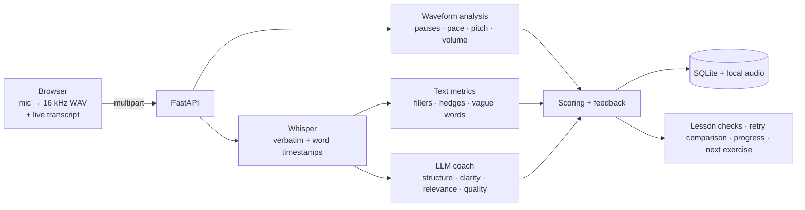

# Thought → Speak

**A personal AI communication coach that listens to how you actually speak.**
Learn a framework → answer out loud → get coached on content *and* voice → retry → compare.


Most people don't have a knowledge problem — they have an articulation problem. You know the answer,
but under pressure it comes out as background first, point last, with a few "um"s in between.
Thought → Speak is built to close that gap, and to make you *less* dependent on AI, not more:
in Challenge Mode it coaches with questions and never writes your answer for you.

## Features

**Learn**
- *Communication Mastery* journey — 10 short lessons in 3 modules: BLUF, PREP, Rule of three,
  Pause-don't-fill, Acknowledge–Bridge–Answer, What / So what / Now what, STAR, the abstraction ladder,
  precise words, and landing the ending.
- Each lesson: concept → framework card → cheat sheet → before/after example → spoken exercise with
  explicit pass criteria. Your answer is scored against *that lesson's* framework.
- **Today's session (~15 min):** a no-prep warm-up, your current lesson, and a review drill on your weakest skill.

**Pronounce — new in v5**


- **Read-aloud drills** in 7 sets: technical clarity, word stress, TH, V/W, R/L, short vs long vowels, word endings.
- **Word-by-word result:** what you read is aligned with the target sentence; every word is marked clear,
  unclear, swapped ("think" heard as "sink") or missed.
- **Likely sound swaps:** when the recognizer hears a different word, the two words' dictionary pronunciations
  (CMU Pronouncing Dictionary) are compared to name the likely swap (`th → s`, `v → w`, `r → l`, long *ee* →
  short *i*), tracked per sound group over time. This is word-level evidence, not a phoneme-level measurement.
- **Stress & respelling** for any word — `development` → dih-VEH-luhp-muhnt — plus ▶ hear / 🐢 slowly
  (browser text-to-speech) and minimal-pair drills.


**Words & sentences — new in v5**


- **Vocabulary:** variety, share of precise (less common) words, vague/weak wording with stronger alternatives,
  repeated words, and **3 words of the day** from a 60-word professional word bank — the coach checks if you used them.
- **Sentence structure:** sentence lengths (from punctuation or your pauses), run-ons, repeated openers,
  passive voice, and basic grammar checks (`he don't`, `there's many`, `a hour`…). With an API key, the AI adds
  context-aware word upgrades and grammar notes.
- **Speak Clearly journey:** 9 lessons — word stress, technical words, endings, TH, V/W, R/L, precise words,
  varied sentences, active voice.

**The 28-Day Speaking Sprint — new in v7**
- A daily program: one real-world speaking skill per day, ~10 minutes, four themed weeks
  (Foundations → Voice & presence → Conversations → Influence), ending with your signature talk.
- Each day: concept, framework, cheat sheet, before/after example, and a spoken exercise with pass criteria.
- The next day unlocks the following morning in your timezone; streaks and weekly milestones keep you going.
- Program content lives in `content/programs/speaking-sprint-28.json`.

**Focused results — new in v8.3**
- Every take opens on three things: **Keep doing**, **Fix first** and **On your retry**. The full review, your
  voice, words & sentences and measurements are one click away.
- Quotes are your exact words, verified against the transcript; ▶ jumps to the moment in your recording when
  Whisper timed it. Nothing is quoted that you didn't say, and no timestamp is guessed.

**Feedback from three angles — new in v8**
- **Evaluator:** the interviewer / audience / customer gives a verdict, quotes what landed and what raised a
  doubt, and asks the follow-up they'd ask next (one click to practise it).
- **Corrections:** every sentence that needs work as "You said → Say", with what changed — false starts,
  run-ons, grammar, fillers and vague words — plus your whole answer corrected.
- **Part by part:** your answer split into its framework parts, quoting your own words.
- **Coach:** top three fixes, a plan for the next take, a 2-minute drill, and (with an API key) a stronger
  version of your own answer.
- **Mentor:** your pattern across recent takes, what's improving, and one habit for the week.

**Practice**
- Five scenarios — Interview, Leadership, Technical explanation, Toastmasters, FDE / Customer — or your own prompt.
- Scores for **structure, clarity, relevance, answer quality and delivery**, plus a framework check.
- **Retry loop:** retries are chained to the same prompt and compared take by take.
- **Challenge Mode:** Socratic questions and a hint only; the server strips any outline or rewrite.

**Your voice — measured from the recording, not the transcript**


| Metric | How it's measured |
|---|---|
| Pauses: natural (< 1 s), long (1–2.5 s), **stalls** (> 2.5 s) | energy-based voice activity detection on 20 ms frames, adaptive noise floor |
| Pace overall, while talking, and every 10 s | speaking window + Whisper word timestamps |
| **Pitch variety** (monotone / limited / expressive) | autocorrelation F0 tracking (75–400 Hz), range in semitones |
| Volume consistency and **trailing off** | speech-frame dB, last 15 % vs. the body |
| Fillers that speech-to-text usually deletes | Whisper with a disfluent prompt so "um / uh" are kept |
| Unclear words in free speech | local Whisper per-word confidence (< 50 %) |

**Progress** — score trend, skills last-10 vs. previous-10, average gain from retrying, streak,
per-scenario stats, top filler words, and a personalised next exercise.

| Coaching | Progress |
|---|---|
|  |  |

## Quick start

```bash
git clone https://github.com/Gayathri2016/thought-to-speak.git
cd thought-to-speak
python -m venv .venv && source .venv/bin/activate      # Windows: .venv\Scripts\activate
pip install -r requirements.txt
cp .env.example .env                                   # optional: add OPENAI_API_KEY
uvicorn app:app --reload
```

Open <http://127.0.0.1:8000> in Chrome or Edge (live transcript). The microphone works only on `localhost` or HTTPS.

**Optional — free offline transcription:** `pip install -r requirements-whisper.txt` installs
[faster-whisper](https://github.com/SYSTRAN/faster-whisper); the `base.en` model (~140 MB) downloads on first use.

| `.env` setting | Effect |
|---|---|
| none | Works fully offline: local heuristic scoring + waveform analysis + browser transcript |
| `OPENAI_API_KEY` | AI coaching feedback and Whisper API transcription |
| `ANTHROPIC_API_KEY` | AI coaching feedback via Claude (used when no OpenAI key is set) |
| `LLM_PROVIDER`, `TRANSCRIBE_PROVIDER` | Force `openai` / `anthropic` / `local` / `none` |
| `AUTH_MODE` | `accounts` (default): sign-in required, data private per user · `single`: no sign-in, one local user |
| `DAILY_TAKE_LIMIT` | Analyzed takes per user per day (default 60, `0` = unlimited) |
| `COOKIE_SECURE` | `auto` (default) · `1` behind an HTTPS proxy |

**Accounts.** On first launch you'll see a sign-up screen. The first account you create takes over any practice
you recorded before accounts existed. Prefer no sign-in for personal use? Set `AUTH_MODE=single`.

## How it works



Design choices:
- **Modular monolith.** One process, clear boundaries: thin routers → services → domain modules → storage.
- **Your timezone.** The browser sends its IANA timezone; daily plans, program unlocks, practice days and streaks follow your calendar. The daily quota resets at midnight UTC.
- **LLMs judge, code counts.** Fillers, hedges, pace, pauses and pitch are computed deterministically; the model
  only scores content. If the LLM call fails, you get local analysis instead of an error.
- **Delivery = 40 % words + 60 % voice.**
- **Lessons are data.** Each `content/*.json` file is a journey, validated at startup. Pass checks can use
  `overall`, `framework_coverage`, `scores.*`, `metrics.*` or `voice.*`.
- **Private by default.** Every take belongs to an account and is visible only to it. History and recordings
  are stored in `data/`. Transcripts go to your AI
  provider only if you configure one. Chrome's live transcript uses Google's speech service.

```
app.py                 composition root: config, domain objects, routers, static files
routes/auth.py         sign up / in / out, delete account
routes/practice.py     analysis jobs (submit, poll), audio, prompts, config, usage
routes/curriculum.py   journeys, lessons, today's plan, programs, pronunciation, word bank
routes/progress.py     progress, recommendation, comparisons, history, export
routes/deps.py         app context, signed-in user, user timezone + clock
coach/service.py       analysis orchestration: validate → transcribe → measure → score → save (audio lifecycle)
coach/jobs.py          persistent jobs, atomic quota reservation, idempotency, worker pool, restart recovery
coach/schemas.py       typed request / response / result-invariant schemas
coach/provider_schema.py  typed validation of AI output before it is merged
coach/analysis.py      heuristic + LLM analysis, Challenge Mode guard
coach/review.py        evaluator / coach / mentor review and part-by-part breakdown
coach/evidence.py      quote verification against the transcript, Whisper timestamps, Challenge Mode redaction
coach/corrections.py   sentence corrections: false starts, run-ons, fillers, grammar
coach/scoring.py       scoring provenance (versions, rubric fingerprint, transcript source) + compatibility
coach/audio.py         waveform analysis and voice scores (numpy)
coach/transcribe.py    Whisper: OpenAI API or local faster-whisper
coach/metrics.py       fillers, hedges, vague words, WPM
coach/curriculum.py    journeys, programs, lesson pass checks, daily plan
coach/pronunciation.py read-aloud alignment, likely sound swaps, stress & respelling
coach/language.py      vocabulary, sentence structure, grammar checks, word bank
coach/insights.py      retry comparison (cached narratives), progress, recommendation
coach/storage.py       SQLite + additive migrations; per-user view (UserStore)
coach/auth.py          passwords (scrypt), sessions, rate limits, quotas
content/               journeys, programs, pronunciation drills, word bank, lexicon
static/index.html      UI shell; static/app.css styles
static/js/             native ES modules, no build step: core · api · recording · results · curriculum ·
                       progress · auth · main (entry)
scripts/eval_scoring.py  scoring benchmark (tests/benchmark/)
tests/                 pytest
```

## Adaptive learning

- **Baseline (3 minutes).** New users answer three short prompts — an interview answer, an explanation and an
  impromptu talk. They set the starting level for each skill.
- **Skill reviews.** Every scored take is evidence for five skills (structure, clarity, relevance, substance,
  delivery). Each skill sits in a Leitner box with reviews every 1, 2, 4, 7, 14 or 30 days:
  score **75+ when it's due** → up a box; **under 60 any time** → back to box 1 (review tomorrow); 60–74 → same
  box, rescheduled. Scoring 75+ before a skill is due doesn't move it (no credit for cramming). Each skill shows
  the one-sentence reason for its current box. Today's session reviews the most overdue skill.
- **Weekly challenge.** One prompt per week from a held-out bank used nowhere else in the app, never one you've
  answered before. Only your first take counts, so the weekly score measures **retained skill** on an unseen
  prompt — separate from how much a same-prompt retry helped. Progress shows it as "Retained skill (weekly)".

## Scoring you can trust

Every take records **how** it was scored: the scorer (`ai`, `heuristic` or `mixed`) and its version, the AI
model, a fingerprint of the rubric it was judged against, and where the transcript came from. Scores from
different scorers are never averaged or compared as if they meant the same thing:

- A retry scored differently from the take before it shows **"Not comparable"** with the reason, instead of a
  misleading "+12".
- Progress averages only use takes from your current scorer; older ones are shown faded in the trend.
- Filler counts are only compared between takes from the same transcription source (Whisper keeps "um/uh",
  browser speech-to-text drops many of them).
- In the results, each score is tagged **AI** (judged by the AI coach), **est.** (built-in estimate) or
  **formula** (delivery, computed from measured signals). Untagged numbers are measured.

Scoring regressions are caught by a small human-ranked benchmark:

```bash
python scripts/eval_scoring.py                    # built-in scorer vs. saved baseline (also runs in pytest)
python scripts/eval_scoring.py --update-baseline  # after an intentional change — bump HEURISTIC_VERSION first
RUN_LIVE_EVAL=1 pytest -m live                    # optional: evaluate your configured AI provider (API cost)
```

## Reliable analysis

Each take is saved as an **analysis job** before any expensive work starts:

1. The browser submits the take with an **idempotency key** (one per take). Re-clicking, a network retry or a
   refresh can't create a second take or a second AI call — the same key returns the same job. The key is kept
   only while the outcome is unknown (dropped connection, server error); once the job has finished — or failed —
   pressing Analyze again starts a new job.
2. The server validates it (length, lesson, upload size, real audio duration) and, in one database transaction,
   creates the job and **reserves one unit of your daily quota** (including "analyze without saving").
3. A background worker processes it: queued → running → completed / failed. Refresh the page at any time —
   the app picks up the job and shows the result when it's ready.
4. Completed jobs consume the quota unit; failed jobs refund it.

| Situation | What happens |
|---|---|
| Too short, unknown lesson, locked day, upload too big/long | Rejected immediately — no job, no quota used |
| Whisper hears nothing / unreadable audio | Job fails with the reason; quota refunded; not retried |
| AI or Whisper times out | Falls back to built-in analysis inside the job (the take still completes) |
| App restarts mid-analysis | Job is re-queued on start-up (up to `JOB_MAX_TRIES`, default 3), then failed + refunded |
| App restarts after the take was saved | The re-run finds the saved take (one take per job) and finishes from it — no second take, no second analysis, skills updated once |
| Unexpected error | Job fails, quota refunded, you can submit again — unless the take was already saved, then the job completes |
| You delete a take | Its job keeps the quota accounting but loses the stored request and result (shown as "deleted"); replaying its key returns that job and never re-creates the take; skills and baseline are recomputed without it |

Limits worth knowing: workers run inside the app process, so run **one** uvicorn worker process. Processing is
*at-least-once*: if the process dies during an AI call, that call may be repeated after restart (bounded by
`JOB_MAX_TRIES`). Once a take is saved it is never analyzed again. Temporary audio lives in `data/tmp` and is
moved to `data/audio/<job id>.wav` when a take is saved (a re-run finds it in either place); unreferenced temp
files are deleted after an hour. Saved recordings are never deleted automatically.
Comparison narratives are generated once per pair of takes and cached.

API: `POST /api/jobs` (JSON) or `POST /api/jobs/audio` (multipart) with an `Idempotency-Key` header → `202`
with the job; poll `GET /api/jobs/{id}`; `GET /api/jobs?active=true`; `GET /api/usage`. The older
`POST /api/analyze` and `/api/analyze-audio` still work and wait for the result.

## Tests

```bash
pip install -r requirements-dev.txt
pytest -q          # includes the browser take-controller tests (node --test tests/js/takes.test.mjs) if Node is installed
```

## Limitations

- Pitch tracking and pause detection are signal-processing heuristics, not trained models; background noise
  lowers accuracy (the app warns when the recording is quiet or noisy).
- Pronunciation is assessed **at the word level** (what the recognizer heard vs. what you were asked to read),
  not phoneme by phoneme. A recognizer can "autocorrect" a slightly off word, so a clean result means you were
  understood — not that every sound was perfect. Unclear-word confidence needs local Whisper.
- Without an API key, content scores are keyword heuristics — directional, not precise.
- Single-user, local app. Multi-user deployment would need auth, per-user storage and rate limiting.

## Roadmap

- Follow-up interviewer agent that probes your answer in real time
- "Idea spark" hints that fade as you improve
- AI-generated prompts tailored to a role or job description
- Conversation simulator (small talk, difficult customer)

See [CHANGELOG.md](CHANGELOG.md) for version history.

## License

[MIT](LICENSE). `content/lexicon/cmudict_common.txt` is a subset of the
[CMU Pronouncing Dictionary](https://github.com/cmusphinx/cmudict) (BSD-style license, see
`content/lexicon/LICENSE-cmudict`). Word-frequency data comes from the
[wordfreq](https://github.com/rspeer/wordfreq) package (installed via pip, not bundled).
